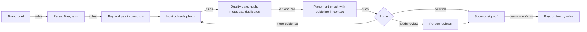

# Tablematch — Deliverable 2: Simplified workflow

**Claim.** Tablematch pairs one AI judgment with deterministic, rule-based steps. In the 15-step deal flow, a
model is called in exactly one place: deciding whether a proof photo shows the sponsor's placement. Eleven
steps are fixed rules and three are people. Rules sit on both sides of the AI: a quality gate before it, so
unusable photos never reach the model, and routing rules after it, so the model's answer never moves money or
rejects anyone on its own.

| Item | Where |
| --- | --- |
| Matching rules | https://github.com/wop29/TableMatch-Vf/blob/main/app/matching.py |
| Fee and escrow rules | https://github.com/wop29/TableMatch-Vf/blob/main/app/payments.py |
| Evidence rules (gate, hashing, risk, routing) | https://github.com/wop29/TableMatch-Vf/blob/main/app/evidence.py |
| The AI step and its routing rules | https://github.com/wop29/TableMatch-Vf/blob/main/app/vision.py |

---

## 1. The design principle

Use a model only where the input is open-ended and a rule cannot capture it. Everything that is a lookup,
a constraint, a calculation or a state change stays deterministic, so it is instant, free, explainable and
testable. Where money or a person's reputation is at stake, the AI informs and rules or people decide.

| Question we asked of each step | If yes |
| --- | --- |
| Is the input a fixed vocabulary, a number or a known state? | Rule |
| Must the answer never be wrong (a budget limit, a fee, a sold-out slot)? | Rule |
| Does a person need to see exactly why? | Rule with an explanation |
| Is the input unstructured and different every time (a photo of a dinner table)? | AI |
| Does the decision move money or affect someone's standing? | Person, informed by rules and AI |

## 2. The workflow, step by step

| # | Step | Done by | How it works | Why this choice |
| --- | --- | --- | --- | --- |
| 1 | Read the brand's brief into tags and a budget | Rules | Keyword lists for 12 vibes, 8 audiences, 12 interests, 7 neighborhoods, 3 boroughs, 6 placement types; a pattern for dollar amounts | The vocabulary is small and fixed. Rules are instant and show what they understood ("We read: Williamsburg, \$700, menu") |
| 2 | Remove events the brand cannot buy | Rules | Hard filters: open slot of the wanted type, at least one slot within budget, brand category not excluded by the host, category not already taken at that event, event not at its sponsor limit, user filters | A hard constraint must never be wrong. In the eval suite this step has 0 violations across 28 search cases |
| 3 | Rank what is left | Rules | Weighted factors: audience fit 30, interests 20, location 15, vibe and format 15, budget fit 10, engagement 10. Each result lists its reasons | Brands see why each match ranks where it does; weights are tunable |
| 4 | Suggest a funding package for the host | Rules | Best-ranked brands, one per category, within each brand's budget and the host's sponsor limit, until the funding gap is covered | Arithmetic, not judgment |
| 5 | Price, fee, cap | Rules | Fee = 30% of price, never more than \$3,000 per transaction; packages pay one capped fee | Money math must be exact |
| 6 | Escrow states | Rules | awaiting payment -> in escrow -> ready for payout / under review -> released, or refunded | An auditable state machine; funds only move from "ready for payout" |
| 7 | Photo quality gate | Rules | Minimum size and a sharpness measure | Cheap; stops unusable photos before any model cost |
| 8 | Store the evidence | Rules | Original saved untouched, SHA-256 hash, camera metadata, optional face blur on the copy sponsors see | Evidence must be reproducible in a dispute |
| 9 | Duplicate check | Rules | Hash comparison with earlier submissions | Exact matching is a lookup |
| **10** | **Does the photo show this sponsor's placement?** | **AI (Claude Sonnet 5.5)** | The model sees the photo(s), the sponsor, the agreement text and the placement guideline for that slot type (Deliverable 3). It answers three yes/no questions and a confidence, as JSON | **The one step that needs judgment**: every dinner table, menu, screen and lighting condition is different |
| 11 | Turn the AI's answer into a route | Rules | Fixed order, shown below | Consistent and testable; the model never rejects or pays |
| 12 | Risk score and routing | Rules | Weighted signals (AI-image signals 25, similarity to earlier photos 25, metadata problems 15, setting mismatch 15, placement unclear 15, missing evidence 5) into a 0-100 score; bands low / medium / high; must-review triggers force a person | Explainable; property-tested on 2,000 random signal combinations |
| 13 | Review flagged cases | People | Approve, reject, ask for more evidence, escalate, flag fraud; every action logged | Disputes and fraud need accountability |
| 14 | Sponsor sign-off | People | Confirm or dispute; a dispute pauses the payout | The buyer confirms |
| 15 | Release payout | Person confirms, rules compute | Fee deducted and transfer recorded in the ledger | Money moves only on a human click |

**Count: 15 steps. 1 uses a model (step 10). 11 are rules. 3 are people.**

## 3. The rules around the AI, in code

The model's answer (step 10) is turned into a route by this function in `app/vision.py`. The order matters,
and no branch rejects a host or releases money:

```python
def route(raw, threshold=0.80):
    """Deterministic rules from the model's answers to a route. Order matters."""
    if not isinstance(raw, dict):
        return "needs_review", "The AI answer could not be read; a person will check."
    if not raw.get("logo_visible"):
        return "more_evidence", "The sponsor's name or logo is not readable. Please add a clearer photo of the placement."
    if not raw.get("brand_matches"):
        return "needs_review", "The visible brand may not be the sponsor. A person will check before anything is paid."
    if not raw.get("placement_matches"):
        return "more_evidence", "The photo does not show the placement that was bought. Please add a photo of it."
    if float(raw.get("confidence", 0)) < threshold:
        return "needs_review", "The AI is not confident enough to verify on its own; a person will check."
    return "verified", "The placement is shown as agreed."
```

| Model says | Route | Who acts next |
| --- | --- | --- |
| Answer unreadable, or the API failed | Needs review | A person |
| Logo not visible | More evidence | The host adds a clearer photo |
| Logo visible but a different or look-alike brand | Needs review | A person (never an automatic rejection) |
| Right brand, wrong placement type | More evidence | The host adds a photo of what was bought |
| All yes, confidence below 0.80 | Needs review | A person |
| All yes, confidence 0.80 or more | Verified | Sponsor signs off, then a person releases the payout |

The fee rule (step 5), from `app/payments.py`:

```python
def compute_fee(price, rate, cap):
    """Platform fee = rate x price, never more than the cap. Returns (fee, net, capped)."""
    raw = round(price * rate, 2)
    fee = min(raw, cap)
    return fee, round(price - fee, 2), raw > cap
```

## 4. Diagram



Text version of the same flow: brief -> (rules) parse, filter, rank -> (rules) buy and pay into escrow ->
host uploads photo -> (rules) quality gate, hash, metadata, duplicates -> (AI, one call) placement check ->
(rules) route: verified goes to sponsor sign-off; more evidence goes back to the host; needs review goes to a
person, then sign-off -> (person confirms, rules compute) payout.

## 5. Where AI was considered and deliberately not used

| Candidate | Decision | Reason | Evidence |
| --- | --- | --- | --- |
| Reading the brief | Rules for now | Rules read 14 of 15 common briefs exactly. They miss negation ("NOT upscale"), budgets written without "\$", slang ("BK") and typos. A small model is the planned upgrade for those cases only | Offline eval suite, 40 brief cases |
| Ranking events and brands | Rules | People need factor-by-factor reasons; weights must be tunable and stable | 20 brand-side cases: 0 constraint violations, best match in the top 3 in 20 of 20 |
| Fraud decisions | Never AI alone | A false fraud call harms a host's livelihood; AI signals only route to a person | Property test: no signal combination ever produces a rejection |
| Fee and payout | Never AI | Exact arithmetic | Unit tests on fee and cap |
| Support replies | Not built | Planned as small-model drafts that a person approves and sends | |

## 6. What this buys us

| Benefit | Measured or estimated |
| --- | --- |
| Cost | One model call per proof submission, about \$0.005 on Sonnet 5.5 (estimate; Deliverable 5 measures it). Everything else costs nothing to run |
| Speed | Rule steps run in under 30 ms each in the recorded end-to-end run |
| Reliability | Rule steps are deterministic: the offline eval suite returns identical numbers on every run |
| Safety | Money moves only on a person's click; the AI cannot reject or pay |
| Explainability | Every ranking and every risk score carries its breakdown in the interface |
