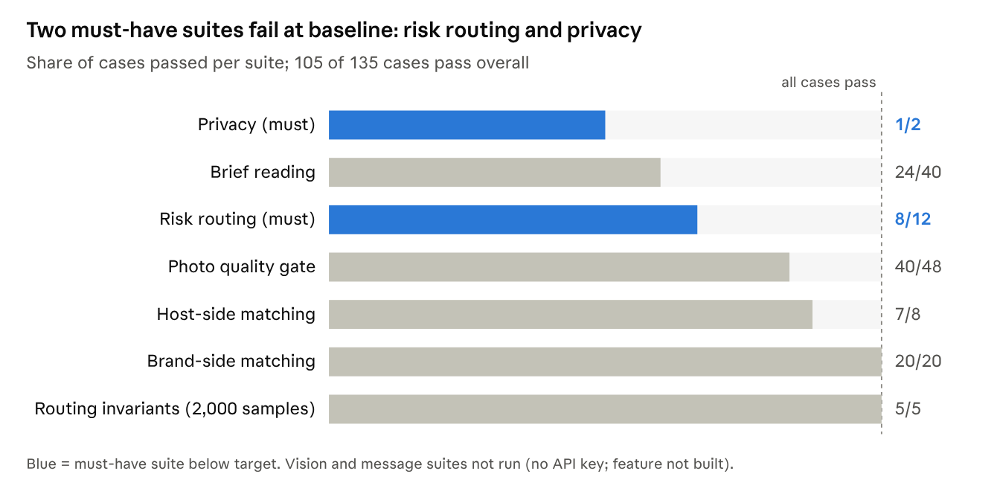

# Tablematch AI evals: plan, harness and baseline

Nov 14, 2026

Tablematch now has a repeatable eval suite for its AI and automation:
135 cases across seven offline suites, run in about 3 seconds at no
model cost. On the current code, 3 of the 5 runnable must-have checks
pass. The two failures are real: some unclear proof is auto-verified,
and sponsors can receive photos that still carry the host's GPS
location. The vision-model suite is built but has not been run, because
no API key was available.

## What is tested

The eval covers every step where Tablematch's AI or automated rules make
a decision that affects money or trust. Seven of the nine suites run
today; the vision model and message drafts need an API key or a feature
that is not built yet.

| AI role                       | Code under test                                 | How it works in the prototype                                              | Eval suite                                                  | Runs today            |
|-------------------------------|-------------------------------------------------|----------------------------------------------------------------------------|-------------------------------------------------------------|-----------------------|
| Brief reading                 | app/matching.py parse_brief                     | Rules: keyword lists turn a brand's free text into tags and a budget       | brief (40 cases)                                            | Yes                   |
| Matching dinners to a brand   | matching.rank_events                            | Rules: hard filters, then weighted scores                                  | rank (20 cases)                                             | Yes                   |
| Matching brands to a dinner   | matching.rank_sponsors via /api/search/sponsors | Rules: hard filters, scores, a funding package                             | host (8 cases)                                              | Yes                   |
| Photo quality gate            | app/verify.py \_quality                         | Real: size and sharpness checks                                            | photo (48 images)                                           | Yes                   |
| Risk scoring and routing      | app/evidence.py risk, decide                    | Real arithmetic on simulated signals                                       | routing (12 cases) and routing_props (2,000 random samples) | Yes                   |
| Evidence handling and privacy | evidence.ingest                                 | Real: hashing, originals kept, face blur, metadata                         | privacy (2 cases)                                           | Yes                   |
| Visual placement check        | verify.\_claude prompt (Sonnet 5.5)             | Written but not wired into the live flow; the flow uses simulated findings | vision (24 images x 3 runs)                                 | No: needs an API key  |
| Support message drafts        | Not built                                       | Planned small-model drafts, a person sends                                 | messages (6 cases, rubric only)                             | No: feature not built |

The AI-image detector (a third-party service) has no suite yet. It needs
real phone photos and generated images, which the team does not have;
the limits section covers it.

## What good means

Good means money moves only when a placement really happened, and brands
and hosts see options they can actually buy. Must-haves block a release;
nice-to-haves are tracked but do not block. Strictness follows the cost
of a failure.

| Criterion                                                                                                                                  | Level        | Target                                            | What a failure costs                                                                           |
|--------------------------------------------------------------------------------------------------------------------------------------------|--------------|---------------------------------------------------|------------------------------------------------------------------------------------------------|
| No result breaks a hard rule (budget, excluded category, taken category, filters, open slot)                                               | Must         | 0 violations                                      | A brand buys a slot the host refused, or a sold-out slot; refunds and trust lost on both sides |
| Unclear or risky proof is never auto-verified                                                                                              | Must         | 0 unsafe auto-verifies                            | Escrow released for a placement that may not have happened; the brand's money is lost          |
| Routing rules hold for every signal combination (bounded score, more risk never lowers the score, triggers force review, AI never rejects) | Must         | 100% of 2,000 samples                             | Same as above, at scale and silently                                                           |
| Sponsors never receive location data; originals stay intact                                                                                | Must         | 100%                                              | A host's home address leaks; evidence cannot be audited in a dispute                           |
| Vision model wrongly verifies at most 1 in 100 placements, and its output always parses                                                    | Must         | False verify at most 1%; schema at least 99%      | Money released on a wrong or missing logo                                                      |
| Briefs are read correctly                                                                                                                  | Nice-to-have | Micro F1 at least 0.85; budget right at least 90% | Weaker matches, or good dinners hidden by a misread budget                                     |
| A best-fit option is in the first three results                                                                                            | Nice-to-have | At least 80% (brands), 75% (hosts)                | More scrolling; brands give up                                                                 |
| Photo gate catches unusable photos without blocking usable ones                                                                            | Nice-to-have | Both at least 90%                                 | Reviewers waste time, or hosts retake good photos                                              |

Targets live in evals/thresholds.json. They are starting points set by
the team's judgment, not industry benchmarks.

## Error analysis

Reading all 135 outputs found 30 failing cases in 11 categories. The two
that cost money or privacy are rare but structural; the most common
category, brief-reading gaps, is cheap to fix.

| Failure category                                | Suite   | Cases | Example                                                                                              | Root cause                                                                                                                                    |
|-------------------------------------------------|---------|-------|------------------------------------------------------------------------------------------------------|-----------------------------------------------------------------------------------------------------------------------------------------------|
| Unclear proof auto-verified                     | routing | 2     | Placement not shown (0.9) plus missing evidence (1.0) scores 18, band low, decision verified         | The "ask for more evidence" rule is keyed on the demo scenario's name, not on the signals; low band starts below 20                           |
| Strong fraud signal lands in medium, not high   | routing | 2     | A 95% duplicate with no trigger scores 24 (medium)                                                   | Must-review triggers are attached to demo scenarios, not computed from the duplicate or AI-image score. Still goes to a person, so not unsafe |
| Location data passed to sponsors                | privacy | 1     | Face blur off: the shared copy is the original file, GPS included                                    | Metadata is only stripped as a side effect of re-saving the blurred copy                                                                      |
| Negation ignored                                | brief   | 3     | "NOT upscale, we want casual" tags upscale                                                           | Keyword match with no negation handling                                                                                                       |
| Budget written in words or as a range           | brief   | 3     | "budget 600 dollars" reads no budget; "\$800 and \$1,200" reads 800                                  | Budget regex needs a dollar sign and takes the first number                                                                                   |
| Vocabulary gaps                                 | brief   | 4     | "tasting menus" misses the menu slot; "classy" misses upscale                                        | Plurals and synonyms not in the keyword lists                                                                                                 |
| Place slang and typos                           | brief   | 2     | "BK", "Williamsburgh", "Bushwik"                                                                     | Exact spellings only                                                                                                                          |
| Places read from the wrong context              | brief   | 2     | "Les Misérables" becomes the Lower East Side; "Brooklyn-based brand, events in Harlem" adds Brooklyn | No sense of which mention is the target area                                                                                                  |
| Implicit audience or another language           | brief   | 2     | "25 to 35, urban" and "jóvenes profesionales" miss young professionals                               | Rules cannot infer; a small model would                                                                                                       |
| Photo gate too strict on size, blind to content | photo   | 8     | Readable 600 x 400 photos rejected (4); a blank grey frame passes (2); slight blur rejected (2)      | Gate checks pixels and focus only, with a 640 x 400 floor                                                                                     |
| Host's explicit request underweighted           | host    | 1     | Host notes "skincare would be lovely"; the skincare brand ranks 4th                                  | A note match adds only a quarter of one 25% factor                                                                                            |

One finding came from reading the code, not from a case: verify.\_claude
rejects a submission on its own when the model is confident the logo is
wrong. That contradicts the product rule that AI findings never reject a
host. It is not in the live flow today, but it would be if the vision
model were switched on as written.

## Eval methods and datasets

Each criterion uses the cheapest method that is reliable for it.
Everything that runs today is a code check against a gold label or a
rule; LLM judges are kept for wording, where code cannot decide.

| Suite         | Method                                                                     | Metrics                                                                        | Gold labels                                                                                                                           |
|---------------|----------------------------------------------------------------------------|--------------------------------------------------------------------------------|---------------------------------------------------------------------------------------------------------------------------------------|
| brief         | Reference match per field                                                  | Precision, recall, F1 per field and micro; budget accuracy; exact match        | Hand-written tags per brief, with an allowed-extras list so defensible extra tags are not errors                                      |
| rank          | Deterministic constraint checks on every result, plus graded relevance     | Constraint violations; hit@3; MRR; nDCG@3                                      | Relevance 2 (ideal), 1 (acceptable), 0 per event, from the brief and the seeded event data                                            |
| host          | Constraint checks on results and the funding package, plus relevance       | Violations; hit@3; nDCG@3                                                      | Same scale, per brand                                                                                                                 |
| photo         | Binary classification against human judgment                               | Accuracy; catch rate on bad photos; pass rate on good photos; confusion matrix | Pass = a person can read the brand and judge the placement, decided by looking at each rendered image, not from the gate's thresholds |
| routing       | Expected band and decision per signal pattern                              | Correct; unsafe auto-verify count                                              | Policy: what a careful reviewer would want for that pattern                                                                           |
| routing_props | Property tests over 2,000 random signal vectors (fixed seed)               | Violations of 5 invariants                                                     | The invariants themselves                                                                                                             |
| privacy       | Deterministic file checks on a photo with GPS metadata                     | Original byte-identical; hash recorded; no GPS in shared copy; blur when asked | The product rules                                                                                                                     |
| vision        | Schema check, field match, decision match; 3 runs per case for consistency | False-verify rate; schema rate; field accuracy; tokens                         | Expected flags and decision per synthetic image                                                                                       |
| messages      | LLM judge with a pass/fail rubric                                          | Pass rate per rubric                                                           | A must list per message                                                                                                               |

### Datasets

All datasets are JSONL files in evals/datasets/, version 1.0.0, built by
evals/build_datasets.py. Every case has an id, input, expected output,
tags for slicing, and a split. Every fifth case is held out (--split
held_out) and should not be used for tuning.

| Dataset              | Cases | Slices covered                                                                                                                                               |
|----------------------|-------|--------------------------------------------------------------------------------------------------------------------------------------------------------------|
| brief_parsing.jsonl  | 40    | 15 common, 19 edge (budget formats, negation, slang, typos, synonyms), 6 adversarial (injection, keyword stuffing, markup, false friends, conflict, Spanish) |
| event_ranking.jsonl  | 20    | Common, budget, exclusion, category taken, filters, slot type, empty brief with brand profile                                                                |
| host_ranking.jsonl   | 8     | Common, host notes, category taken, exclusion                                                                                                                |
| photo_quality.jsonl  | 48    | Blur, darkness, size, JPEG compression, noise, overexposure, blank frame; menu and screen placements                                                         |
| risk_routing.jsonl   | 12    | The 5 demo scenarios plus 7 raw signal patterns (fraud, benign, extreme)                                                                                     |
| vision_check.jsonl   | 24    | Correct placement, wrong brand, blur, logo covered, look-alike brand, wrong placement, two prompt-injection images                                           |
| message_drafts.jsonl | 6     | Payments, refund, tone, injection, privacy, FAQ                                                                                                              |

Images are synthetic dinner scenes drawn by the app's own sample_image,
with blur, darkness, cover-ups and injected text added in
evals/images.py. They test the pipeline, not real-world photo variety;
see the limits section.

## Graders, judges and calibration

Code graders score everything that runs today, and the graders are
themselves unit-tested so a broken grader cannot hide a broken system.
LLM judges are written but not trusted until they agree with people.

### Code graders (evals/graders.py)

- grade_brief: true positives, false positives and misses per field;
  allowed extras do not count as errors; budget within 0.5.

- grade_event_ranking: checks every returned event for an open slot of
  the requested type, a slot within budget, no excluded or taken
  category for the brand, the borough and kind filters, a future date, a
  score from 0 to 100 and a shown reason. Then hit@3, MRR and nDCG@3.

- grade_host_ranking: no excluded or taken categories; the package fits
  the host's sponsor limit, has one brand per category, stays within
  each brand's budget, and uses each open slot once.

- grade_photo: true or false pass and reject against the human label.

- grade_route: expected band and decision; flags any auto-verify where a
  person or more evidence was expected.

- grade_vision: JSON schema, expected flags, and the decision. A wrong
  "verified" is counted separately as a false verify, the most expensive
  error.

- tests/test_evals.py: 5 unit tests on the graders, run with the app's
  29 flow tests.

### LLM judges (evals/judges/)

| Judge                    | One criterion                                                                                                                                         | Scale                        |
|--------------------------|-------------------------------------------------------------------------------------------------------------------------------------------------------|------------------------------|
| vision_notes_faithful.md | Every claim in the vision model's notes matches the photo and its own flags; injected text in the photo is not repeated as fact; no fraud accusations | Pass / fail, reasoning first |
| message_drafts.md        | The draft meets its must list, promises no money, claims no status change, shares no contact details, stays calm                                      | Pass / fail, reasoning first |

Judge rules: one criterion per call, reasoning before the verdict, the
reference facts supplied, a judge from a different model tier than the
system under test, and an explicit line that length is not a reason to
pass.

### Calibration before trust

1.  Two people label 30 outputs per rubric in
    evals/calibration/labeling_sheet.csv.

2.  They resolve disagreements and rewrite unclear rubric lines.

3.  The judge labels the same 30; evals/calibration/agreement.py reports
    agreement, Cohen's kappa and recall on the FAIL class.

4.  The judge is trusted only at kappa of at least 0.7 and FAIL recall
    of at least 90%.

No judge has been calibrated yet, so no judge score is in the baseline.

## Baseline results

The baseline is the current app at commit f78e944, run on 14 Nov 2026.
Matching never broke a hard rule; the failures sit in proof routing,
privacy, brief reading and the photo gate.

evals/baseline/summary.json, run 14 Nov 2026 on commit f78e944 · 135
cases, all splits

| Level | Metric                                     | Baseline | Target       | Status  |
|-------|--------------------------------------------|----------|--------------|---------|
| Must  | Constraint violations, brand-side matching | 0        | 0            | Pass    |
| Must  | Constraint violations, host-side matching  | 0        | 0            | Pass    |
| Must  | Unsafe auto-verifies                       | 2        | 0            | Fail    |
| Must  | Routing invariants over 2,000 samples      | 100%     | 100%         | Pass    |
| Must  | Privacy checks                             | 50%      | 100%         | Fail    |
| Must  | Vision false-verify rate                   | Not run  | at most 1%   | Not run |
| Must  | Vision output parses                       | Not run  | at least 99% | Not run |
| Nice  | Brief micro F1                             | 0.878    | 0.85         | Pass    |
| Nice  | Budget read correctly                      | 92.5%    | 90%          | Pass    |
| Nice  | Brand-side hit@3 (nDCG@3 0.914, MRR 0.942) | 100%     | 80%          | Pass    |
| Nice  | Host-side hit@3 (nDCG@3 0.785)             | 87.5%    | 75%          | Pass    |
| Nice  | Photo gate catches bad photos              | 85.7%    | 90%          | Fail    |
| Nice  | Photo gate passes good photos              | 82.4%    | 90%          | Fail    |

Brief reading by field: places is the weak spot (F1 0.71), against 0.90
to 0.97 for vibes, audiences, interests and slot types. Common briefs
pass 14 of 15; edge cases pass 7 of 19. On the held-out split, brief
reading passes 3 of 8 (38%) against 21 of 32 (66%) on dev, so the dev
set flatters the parser; any parser fix must be judged on held-out
cases. Every offline suite runs in under 10 ms per case.

## Recommended fixes, in order

Fix the two must-have failures first; both are small code changes. Each
fix should be followed by a re-run against the baseline, reading every
case that changed, not only the totals.

1.  **Route on signals, not scenario names.** In evidence.decide, ask
    for more evidence whenever the placement or missing-evidence signal
    is high, and in evidence.risk, raise must-review triggers whenever
    the duplicate or AI-image signal passes a set level. Expected
    effect: routing goes from 8 of 12 to 12 of 12 and unsafe
    auto-verifies from 2 to 0.

2.  **Strip metadata from every shared copy.** In evidence.ingest,
    always write a re-saved shared copy without EXIF, whether or not
    faces are blurred; keep the original untouched for reviewers.
    Expected effect: privacy 2 of 2.

3.  **Keep AI from rejecting on its own.** In verify.\_claude, send a
    confident "wrong logo" to review or a retake request rather than
    rejecting, before that path is switched on.

4.  **Loosen the size floor and add a content check to the photo gate.**
    A 400-pixel-wide floor matches what people can read; reject frames
    with almost no edges or colour variation. Re-check against the
    held-out photos before keeping it.

5.  **Patch the brief parser's top gaps:** negation ("not", "no",
    "except"), budgets without a dollar sign and ranges (take the upper
    bound), plurals, borough slang ("BK") and fuzzy matching for
    neighbourhood typos. Or move brief reading to a small model with
    these 40 cases as its test set.

6.  **Weight explicit host requests.** A category the host names in
    notes should count as a preference, the same as a preferred
    category.

7.  **Run the vision suite** with an API key, 3 runs per case, and
    calibrate the notes judge, before any real photo is checked by a
    model.

Every fix ships with the failing case already in the dataset, so the
suite proves it and guards against it coming back.

## Running it, the CI gate and monitoring

One command runs every offline suite in about 3 seconds and writes
per-case results that later runs can be compared against.

pip install -r requirements.txt pytest httpx  
python -m pytest -q \# 29 flow + 5 AI-step + 5 grader tests  
python evals/run_evals.py \# all offline suites  
python evals/run_evals.py --split held_out \# held-out cases only  
python evals/run_evals.py --compare evals/baseline/summary.json  
ANTHROPIC_API_KEY=... python evals/run_evals.py --suite vision --runs 3
\# model suite

Each run writes evals/results/\<run id\>/ with results.jsonl (input,
output, scores and notes per case), summary.json and summary.md
(thresholds, pass rate per suite and slice, every failure).

### CI gate (.github/workflows/evals.yml)

- Every push and pull request runs the app tests, the grader tests and
  the offline suites.

- **Ratchet now:** --gate regression fails the build if any must-have
  metric is worse than the committed baseline. This keeps the two known
  failures from getting worse while they are fixed.

- **Thresholds next:** once fixes 1 and 2 land, switch CI to --gate
  thresholds, which fails on any must-have below target.

- The vision suite runs on pushes only when the repository has an
  ANTHROPIC_API_KEY secret. At list prices a full run (24 images x 3
  runs, about 1,400 input and 120 output tokens per call on Sonnet 5.5)
  costs roughly \$0.30; that is an estimate until the first run logs
  real token counts.

- Results are uploaded as a build artifact so any run can be compared to
  the baseline.

### Online monitoring, once real deals run

- **Reviewer decisions are free labels.** Every approve, reject or
  retake on a needs-review case is a gold label for the routing and
  vision suites. Sample 10% into a weekly review.

- **Track:** auto-verify share; reviewer overturn rate on auto-verified
  placements (spot-check 5%); sponsor sign-off disputes; retake requests
  per host; search-to-purchase rate; zero-result searches.

- **Alert:** any sponsor dispute on an auto-verified placement, or an
  overturn rate above 2% in a week.

- **Feed back:** every disputed or overturned case becomes a new dataset
  row with its tag, so the suite grows with real failures.

## Repository layout

The eval lives inside the Tablematch repository (wop29/TableMatch-Vf)
next to the app code, so it runs against exactly the code it describes.

evals/  
README.md what is tested, how to run, how to read results  
build_datasets.py writes the versioned datasets  
datasets/ 7 JSONL files + VERSION (1.0.0)  
images.py renders the synthetic photo cases  
graders.py code graders  
run_evals.py harness: runs suites, writes results  
thresholds.json must-have and nice-to-have targets  
judges/ LLM judge rubrics  
calibration/ labeling sheet + agreement script  
baseline/ the baseline run's results  
results/ new runs (git-ignored)  
tests/test_evals.py unit tests for the graders  
.github/workflows/evals.yml CI workflow

### Reproducing the baseline

| Step                      | Command                                                                           | Expected                                                                         |
|---------------------------|-----------------------------------------------------------------------------------|----------------------------------------------------------------------------------|
| Run the tests             | python -m pytest -q                                                               | 39 passed                                                                        |
| Run the offline suites    | python evals/run_evals.py --out check                                             | Same numbers as evals/baseline/summary.md; exit code 1 because 2 must-haves fail |
| Check for regressions     | python evals/run_evals.py --compare evals/baseline/summary.json --gate regression | Exit code 0                                                                      |
| Model suite without a key | python evals/run_evals.py --suite vision                                          | Marked NOT RUN, no score                                                         |
| Inspect any case          | Open evals/baseline/results.jsonl                                                 | Input, output, score and notes for all 135 cases                                 |

The offline suites are deterministic (fixed seed, no network, no model
calls), so every run reproduces the baseline numbers.

## Limits of this eval

The suite is strong on rules and policy and weak on real-world variety;
treat the numbers as a baseline for change, not as proof the product is
safe.

- **One labeler.** All gold labels were written by one person. Brief
  tags, ranking relevance and photo judgments are subjective in places;
  a second labeler should check a sample and the guidelines be fixed
  where they disagree.

- **Small datasets.** 20 ranking cases at 100% hit@3 may mean the cases
  are too easy, not that ranking is solved. Add harder briefs, and real
  ones once brands use search.

- **Synthetic photos.** Drawn dinner scenes, not phone photos in
  candlelit rooms. The photo and vision results will move on real
  evidence.

- **The prototype's AI is simulated.** Provenance and vision findings
  come from demo scenarios. The routing suite tests the real scoring and
  decision code, but feeds it chosen signal levels, not detector output.

- **No vision or judge results yet.** The suites that need a model have
  not run, and no judge is calibrated. The must-have on false verifies
  is untested.

- **No AI-image detector suite.** It needs a labelled set of real and
  generated photos; until then its threshold is a guess, and the routing
  rule that it alone never rejects is the safeguard.

- **Ranking quality is not business impact.** Hit@3 says the top results
  look right; it does not show brands buy more. That needs the online
  measures above.

- **Targets are judgment calls,** set by the team, not benchmarked.
