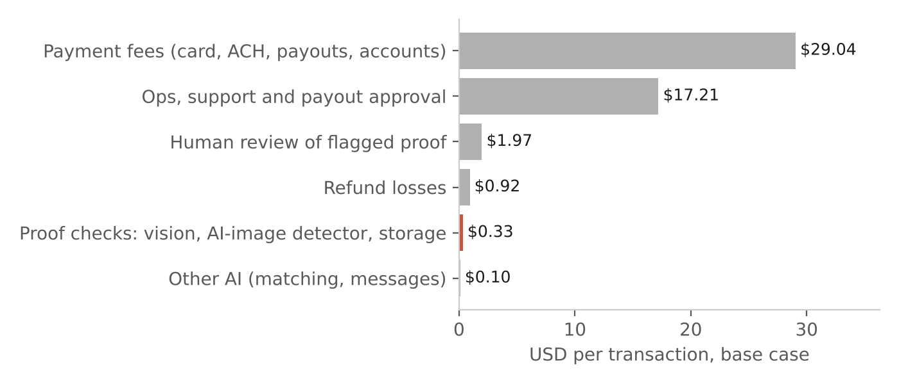
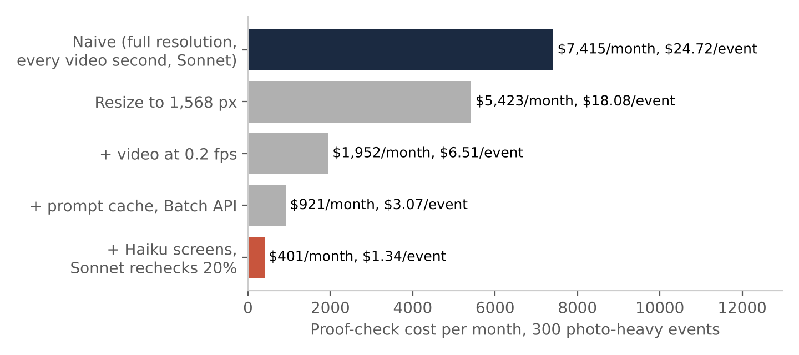
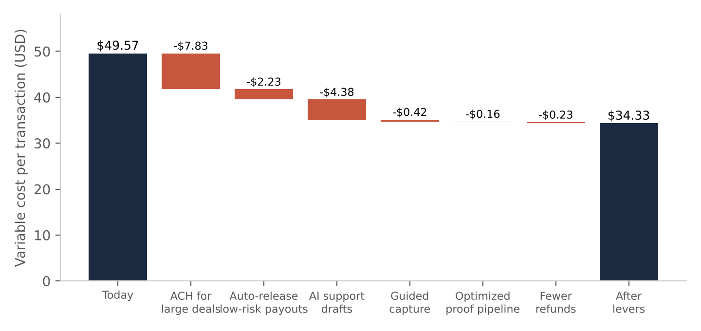
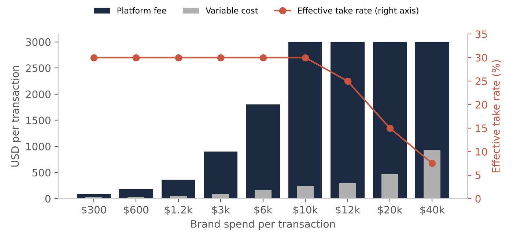
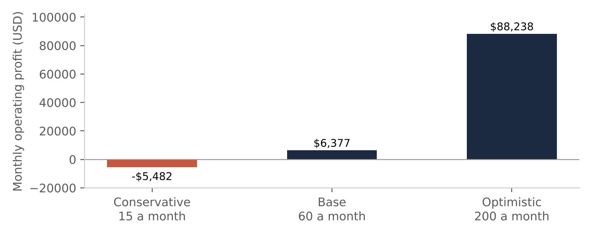

**Tablematch: Unit Economics and Business Model**

An analysis of the sponsorship marketplace for New York supper clubs and
independent events, as designed in the current prototype. November 2026.

# Executive summary

Tablematch is a two-sided marketplace. Brands buy sponsorship placements
at supper clubs, swap meets, artist talks and other small events; hosts
deliver them and prove it with photos and video; Tablematch holds the
money until each placement is verified and keeps a 30% fee, capped at
\$3,000 per transaction. In the base case a transaction averages
\$1,200, earns \$360 in fees and leaves \$310 of contribution profit, a
86% margin. At 60 transactions a month the business covers \$12,249 of
monthly fixed cost and earns \$6,377. Break-even is 40 transactions a
month, or 49 once the cost of acquiring brands is included.

- **The model is asset-light.** Brands supply artwork or product and
  hosts place it, so Tablematch carries no printing, shipping or
  inventory.

- **Payments are the largest cost.** \$29.04 of the \$49.57 variable
  cost per transaction (59%), mostly card fees.

- **People are the second.** Support, payout approval and proof review
  cost \$19.18 per transaction (39%).

- **AI is everywhere in the trust workflow but costs under 1%.** Six AI
  and automation roles cost \$0.43 per transaction. Their value is labor
  avoided and fraud caught, not their own price.

- **Photo-heavy events stay affordable with the right pipeline.** A
  150-guest event with about 1,050 images to check costs \$24.72 done
  naively and \$1.34 with five design choices, against a \$3,000 fee.

- **Six levers cut variable cost by about a third.** From \$49.57 to
  \$34.33 per transaction. Bank transfers for large deals and AI-drafted
  support account for most of it.

- **The open questions are commercial, not technical.** Deal size and
  take rate each move monthly profit by about \$5,427 for a 25% change.
  The pilot should prove average deal value, package share and repeat
  brands.

*Almost every input is an estimate and is labeled as such. Published
figures: Claude API prices and image-token rules, Stripe and Stripe
Connect fees, Sightengine and Cloudflare R2 prices, and BLS New York
wage data. The verification pipeline in the prototype is simulated; its
costs here are list-price estimates for the real services.*

# The business model

Tablematch makes money on completed sponsorships. Three flows matter:

- **Brand to Tablematch.** The brand pays the full price up front, by
  card or bank transfer. Tablematch holds it in escrow.

- **Tablematch to host.** Each placement is paid out separately once its
  proof is verified and a person approves the transfer. The host
  receives the price minus the fee.

- **Tablematch's fee.** 30% of the price, capped at \$3,000 per
  transaction. A package of several placements is one transaction, so it
  pays one capped fee.

| **Design choice**                | **Why it helps**                                                       | **What to watch**                                        |
|----------------------------------|------------------------------------------------------------------------|----------------------------------------------------------|
| Escrow until proof               | Brands buy from hosts they have never met; hosts know the money exists | Payout delays if verification backs up                   |
| Packages and bundle discounts    | Raise value per transaction and placements per brand                   | Discounts erode the fee if bundles do not grow deals     |
| Fee taken from the host's payout | The brand sees one clean price                                         | 30% is steep for small hosts; no public benchmark exists |
| \$3,000 cap                      | Wins large presenting-sponsor deals                                    | Effective take falls to 15% at \$20,000                  |
| Self-serve matching              | No sales or agency labor per deal                                      | Liquidity: enough good events in each neighborhood       |

## Pricing options to test

| **Option**                    | **How it works**                                           | **Effect at a \$1,200 deal**                          |
|-------------------------------|------------------------------------------------------------|-------------------------------------------------------|
| Current: host pays 30%        | Fee deducted from the host's payout                        | Brand pays \$1,200; host gets \$840                   |
| Split fee                     | 15% service fee to the brand, 15% commission from the host | Brand pays \$1,380; host gets \$1,020; same \$360 fee |
| Lower host rate, larger deals | 20% from the host, packages pushed harder                  | Fee \$240; needs about 50% larger deals to match      |
| Add-ons, later                | Faster payouts, premium proof reports, brand subscriptions | Not modeled; test once repeat purchase is shown       |

*The split fee is the strongest candidate: it keeps the platform's
revenue, makes the host offer more competitive, and is common in
marketplaces. No usable public take-rate benchmark for sponsorship
marketplaces was found, so all options need pilot testing.*

# Unit economics per transaction

A transaction is one brand buying one slot or one package at one event.
All figures are dollars per transaction.

| **Line**                                   | **Conservative** | **Base**     | **Optimistic** |
|--------------------------------------------|------------------|--------------|----------------|
| Brand spend (GMV)                          | \$700            | \$1,200      | \$2,000        |
| Placements per transaction                 | 1.3              | 1.8          | 2.4            |
| **Platform fee (30%, cap \$3,000)**        | **\$210.00**     | **\$360.00** | **\$600.00**   |
| Paid to host                               | \$490.00         | \$840.00     | \$1,400.00     |
| Card and ACH collection                    | \$15.92          | \$23.06      | \$26.32        |
| Host payouts (one per placement)           | \$2.78           | \$4.65       | \$7.60         |
| Connect active-account fee                 | \$2.00           | \$1.33       | \$0.67         |
| Images checked                             | 48               | 18           | 10             |
| AI vision check                            | \$1.04           | \$0.28       | \$0.06         |
| AI-image detector                          | \$0.10           | \$0.04       | \$0.02         |
| Evidence storage (12 months)               | \$0.02           | \$0.01       | \$0.01         |
| Human review of flagged proof and disputes | \$4.27           | \$1.97       | \$0.82         |
| Ops, support and payout approval           | \$29.66          | \$17.21      | \$7.75         |
| Refund losses (fees not returned)          | \$0.96           | \$0.92       | \$0.53         |
| Other AI (matching, messages)              | \$0.15           | \$0.10       | \$0.05         |
| **Total variable cost**                    | **\$56.88**      | **\$49.57**  | **\$43.81**    |
| **Contribution profit**                    | **\$153.12**     | **\$310.43** | **\$556.19**   |
| Contribution margin (of fee)               | 73%              | 86%          | 93%            |
| Brand acquisition cost per transaction     | \$333.33         | \$60.00      | \$15.00        |
| **Contribution after acquisition**         | **(\$180.22)**   | **\$250.43** | **\$541.19**   |

*Acquisition assumes \$2,000 / \$1,000 / \$600 to win a brand, 1.5 / 2.5
/ 4 transactions per brand a month and 75% / 85% / 90% monthly
retention. These are hypotheses. The conservative case uses
full-resolution photos and a \$700 average; the optimistic case stacks
favorable guesses and is an upper bound, not a forecast.*

# Where the costs are

Five cost centers make up the \$49.57 of variable cost in a base-case
transaction.

| **Cost center**                       | **Per transaction** | **Share** | **What drives it**                                                               |
|---------------------------------------|---------------------|-----------|----------------------------------------------------------------------------------|
| Payments                              | \$29.04             | 59%       | Card fees (2.9% + \$0.30), one payout per placement, \$2 per active host account |
| People: ops, support, payout approval | \$17.21             | 35%       | About 20 minutes per deal plus 2 minutes per payout approval, at \$43.75 an hour |
| People: proof review and disputes     | \$1.97              | 4%        | 15% of placements flagged at 6 minutes; 3% disputed at 20 minutes                |
| Refund losses                         | \$0.92              | 2%        | 4% of deals refunded; card fees are not returned                                 |
| AI and evidence tech                  | \$0.43              | 1%        | Vision checks, AI-image detection, storage, matching and messages                |

*Base case. Fixed costs sit outside this view: technology \$450, team
\$9,000, sales and marketing \$2,000, legal and insurance \$700 and the
AI-image detector plan \$99 a month. Team cost is an estimate; unpaid
founders hide it rather than remove it.*

# Where AI works in the business

AI and automation sit in six places. Most of them protect trust in the
proof of placement, which is what lets brands pay strangers and lets
Tablematch release money without a person checking every photo.

| **Role**                        | **Where**                   | **Status in the prototype**            | **Model or method**          | **Cost per transaction** | **What people still do**               |
|---------------------------------|-----------------------------|----------------------------------------|------------------------------|--------------------------|----------------------------------------|
| Brief reading and matching      | Sponsor search, host search | Rules (no model)                       | Haiku 5.5                    | \$0.010                  | Brand and host choose                  |
| Messages and support drafts     | Offers, bids, questions     | Not built                              | Haiku 5.5                    | \$0.090                  | Ops approves sensitive replies         |
| Evidence intake and provenance  | Evidence center             | Hash and metadata real; rest simulated | No language model            | \$0.013                  | None                                   |
| AI-image and manipulation check | Every proof image           | Simulated                              | Sightengine (or similar)     | \$0.037                  | Never rejects on its own               |
| Visual placement check          | Every proof image           | Simulated                              | Sonnet 5.5 (Haiku to screen) | \$0.279                  | Reviewer on medium and high risk       |
| Risk scoring and routing        | After every submission      | Rules, real                            | No language model            | \$0.000                  | People approve, reject, pay and refund |

*Costs are base case. Risk scoring and intake use no language model. The
visual check is the only AI cost that scales with the number of photos.*

## What AI is worth, beyond its cost

- It replaces review time. If a person looked at every placement for 4
  minutes, review would cost about \$5.25 per transaction instead of
  \$1.97, and payouts would wait for a reviewer.

- It catches reused or generated evidence before money moves, which
  protects the escrow promise to brands.

- It never decides alone. AI findings route a case; people approve,
  reject, pay and refund, and every action is logged.

# What proof checking costs

Each image passes through five modules: intake (hash and metadata),
provenance (content credentials, duplicates, AI-image signals), a visual
check against the agreement, risk scoring and a decision. The table
prices the real services.

| **Component**                              | **How it is priced**                                               | **Cost per image** |
|--------------------------------------------|--------------------------------------------------------------------|--------------------|
| AI vision, Sonnet 5.5, full resolution     | Up to 4,784 image tokens + 1,500 prompt + 400 output, x1.3 retries | \$0.0215           |
| AI vision, Sonnet 5.5, resized to 1,568 px | 2,352 image tokens, same prompt and output, x1.3                   | \$0.0152           |
| AI vision, optimized                       | Resized, 80% of prompt cached (0.05x), Batch API (50% off), x1.2   | \$0.0057           |
| AI-image detector                          | Sightengine overage price, one operation per image assumed         | \$0.0020           |
| Duplicate detection                        | Perceptual hash on our own servers                                 | \$0.0001           |
| Storage                                    | 4 MB photo for 12 months at \$0.015 per GB-month                   | \$0.0007           |

*Image tokens follow the Claude rule: one token per 28 x 28 pixel patch,
capped at 4,784 for high-resolution models. Prompt and output token
counts are estimates.*

A base-case transaction produces about 18 images (4 photos per
placement, a 30-second video on 30% of placements sampled at one frame
every two seconds, 20% resubmitted), for \$0.33. A budget of \$0.02 per
photo is a safe planning figure until real usage is measured.

# Scenario: an event with lots of photos to verify

This scenario tests the token bill when hosts send a lot of evidence. A
150-guest flagship event has a 5-placement package. Each placement gets
30 photos and 2 videos of 60 seconds, and 40% of placements are
resubmitted. That is about 1,050 images per event when every video
second is analyzed, scaled to 300 such events a month.

| **Pipeline setup**                                                     | **Images per event** | **Per image** | **Per event** | **Per month** | **Tokens per month** |
|------------------------------------------------------------------------|----------------------|---------------|---------------|---------------|----------------------|
| Naive: every photo and every video second, full resolution, Sonnet 5.5 | 1,050                | \$0.0235      | \$24.72       | \$7,415       | 2.11B                |
| Resize photos to 1,568 px                                              | 1,050                | \$0.0172      | \$18.08       | \$5,423       | 1.34B                |
| \+ sample video at 0.2 frames per second                               | 378                  | \$0.0172      | \$6.51        | \$1,952       | 0.48B                |
| \+ cache the agreement prompt, use the Batch API                       | 378                  | \$0.0081      | \$3.07        | \$921         | 0.48B                |
| **+ Haiku 5.5 screens every image, Sonnet 5.5 rechecks 20%**           | **378**              | **\$0.0035**  | **\$1.34**    | **\$401**     | **0.58B**            |

*Per image includes the \$0.002 detector. Each row adds one change to
the row above. Tokens include image, prompt and output tokens; the last
row counts both screening and recheck passes.*

Even the naive pipeline costs \$24.72 on a deal paying a \$3,000 fee,
under 1%. The bill matters only at scale: 2.1 billion tokens and \$7,415
a month for 300 events. The optimized pipeline cuts that by 95%. Human
review does not shrink the same way: five placements, 15% flagged, at 8
minutes per case is about \$4.38 per event. Storage adds about \$0.35
per event for a year of originals.

# Model options to cut AI cost

Each AI role can run on a cheaper model, with a stronger one held back
for the cases that matter.

| **Role**                   | **Default**          | **Cheaper option**                                       | **Escalate to**                         | **Why**                                            |
|----------------------------|----------------------|----------------------------------------------------------|-----------------------------------------|----------------------------------------------------|
| Visual placement check     | Sonnet 5.5           | Haiku 5.5 screens every image; Sonnet rechecks about 20% | Opus 5.5 for disputes only              | Most photos are clear; spend only on unclear ones  |
| AI-image detection         | Third-party detector | Run only on images that pass the visual check            | Human review                            | Detector is billed per image; skip obvious rejects |
| Duplicate detection        | Perceptual hash      | Already near zero                                        | Reverse image search on high-risk cases | No model needed                                    |
| Brief reading and matching | Rules                | Haiku 5.5 when free text is ambiguous                    | None                                    | Rules cover most searches at no cost               |
| Messages and support       | Haiku 5.5 drafts     | Templates for common answers                             | Sonnet 5.5 for disputes and contracts   | Wording errors on money questions are costly       |

| **Model**  | **Per 1,000 images, full resolution** | **Resized to 1,568 px** | **Resized, cached, batch** |
|------------|---------------------------------------|-------------------------|----------------------------|
| Haiku 5.5  | \$0.83                                | \$0.59                  | \$0.24                     |
| Sonnet 5.5 | \$16.57                               | \$11.70                 | \$4.71                     |
| Opus 5.5   | \$33.14                               | \$23.41                 | \$9.42                     |
| Fable 5.2  | \$66.27                               | \$46.82                 | \$18.73                    |

*Before the retry overhead. Opus 5.5 and Fable 5.2 cost 2 to 4 times
Sonnet 5.5 and are not needed to confirm a logo on a menu. Keep a
model-agnostic layer so the default can change with prices or quality.*

# Ways to cut cost across the business

AI is less than 1% of cost, so the bigger savings come from payments and
people. Six levers together take base-case variable cost from \$49.57 to
\$34.33 per transaction, and contribution from \$310.43 to \$325.67.

| **Lever**                             | **What changes**                                                              | **Saves per transaction** |
|---------------------------------------|-------------------------------------------------------------------------------|---------------------------|
| ACH or invoice for deals over \$2,000 | Brand pays by bank transfer; card stays for small deals                       | \$7.83                    |
| Auto-release low-risk payouts         | Verified, low-risk placements pay out after sponsor sign-off without a person | \$2.23                    |
| AI support drafts                     | Model drafts replies and onboarding answers; ops reviews                      | \$4.38                    |
| Guided in-app capture                 | Shot checklist and live framing cut unclear submissions                       | \$0.42                    |
| Optimized proof pipeline              | Resize, sample video, cache, batch, small-model screening                     | \$0.18                    |
| Fewer refunds                         | Deposit and clearer slot specs before purchase                                | \$0.35                    |

*Savings are measured one lever at a time against the base case; the
chart applies them in order. All are estimates until the pilot measures
them.*

- Payments: make bank transfer or invoice the default above \$2,000, and
  consider passing card fees to brands that choose cards.

- People: let verified, low-risk placements pay out automatically after
  the sponsor signs off; keep a person on medium and high risk.

- People: use a small model to draft support answers and onboarding
  replies, with a person sending anything about money.

- Evidence quality: an in-app capture checklist reduces unclear photos,
  resubmissions and reviews.

# How the fee cap changes the take

Up to \$10,000 the platform keeps 30%. Above it the fee stays at \$3,000
while card fees keep growing with the price.

| **Brand spend** | **Placements** | **Fee** | **Effective take** | **Variable cost** | **Contribution** |
|-----------------|----------------|---------|--------------------|-------------------|------------------|
| \$300           | 1              | \$90    | 30%                | \$27              | \$63             |
| \$600           | 1              | \$180   | 30%                | \$34              | \$146            |
| \$1,200         | 1.8            | \$360   | 30%                | \$50              | \$310            |
| \$3,000         | 2.5            | \$900   | 30%                | \$91              | \$809            |
| \$6,000         | 3              | \$1,800 | 30%                | \$157             | \$1,643          |
| \$10,000        | 3.5            | \$3,000 | 30%                | \$245             | \$2,755          |
| \$12,000        | 4              | \$3,000 | 25%                | \$292             | \$2,708          |
| \$20,000        | 4              | \$3,000 | 15%                | \$477             | \$2,523          |
| \$40,000        | 4              | \$3,000 | 8%                 | \$939             | \$2,061          |

*Base-case costs. Contribution peaks near \$10,000 and then falls,
mainly because card fees are 2.9% of the full price. At \$20,000, bank
transfer instead of card saves about \$575.*

# Scenarios and break-even

| **Metric**                            | **Conservative** | **Base**    | **Optimistic** |
|---------------------------------------|------------------|-------------|----------------|
| Transactions per month                | 15               | 60          | 200            |
| GMV per month                         | \$10,500         | \$72,000    | \$400,000      |
| Fee revenue per month                 | \$3,150          | \$21,600    | \$120,000      |
| Contribution per transaction          | \$153.12         | \$310.43    | \$556.19       |
| Fixed cost per month                  | \$7,779          | \$12,249    | \$22,999       |
| **Monthly operating profit**          | **(\$5,482)**    | **\$6,377** | **\$88,238**   |
| **Break-even transactions per month** | **51**           | **40**      | **42**         |
| Break-even after acquisition cost     | Never            | 49          | 43             |

*Fixed cost per month (conservative / base / optimistic): technology
\$250 / \$450 / \$900, team \$6,000 / \$9,000 / \$16,000, sales and
marketing \$1,000 / \$2,000 / \$4,500, legal and insurance \$500 / \$700
/ \$1,500, AI-image detector plan \$29 / \$99 / \$99.*

The conservative case loses money on every brand once acquisition is
counted: a \$700 deal cannot pay back \$2,000 of acquisition cost over
four months. The business works only if deals are larger or brands are
cheaper to win and stay longer.

# Sensitivity

Each driver moves 25% down and 25% up from the base case with the others
fixed. The metric is monthly operating profit at 60 transactions.

| **Driver**                           | **Driver -25%** | **Driver +25%** |
|--------------------------------------|-----------------|-----------------|
| Take rate                            | (\$5,427)       | \$5,427         |
| Average transaction value            | (\$5,011)       | \$5,011         |
| Share paid by card                   | \$282           | (\$282)         |
| Ops and support minutes              | \$219           | (\$219)         |
| Share of placements sent to a person | \$18            | (\$18)          |
| Vision model price                   | \$4             | (\$4)           |
| Photos per placement                 | \$2             | (\$2)           |

*Revenue drivers dominate. Payment mix and ops minutes come next. Photos
per placement and model price barely register.*

# What the pilot should measure

- Average transaction value, share of deals that are packages, and
  repeat brands.

- Which pricing option hosts and brands accept.

- Photos and seconds of video per placement, and how often hosts
  resubmit.

- Share of placements flagged for review, and reviewer minutes per case.

- Real token use per image from API logs, before and after resizing and
  caching.

- Card versus bank-transfer share, especially above \$10,000.

- Refunds, disputes and suspected fraud, and the time each takes.

# Limits of this analysis

- The verification pipeline is simulated in the prototype. No vision,
  detector or storage service has been called, so its costs are
  list-price estimates.

- Prompt and output tokens, frames sampled, photos per placement, review
  rates and minutes are estimates.

- Deal size, package mix and acquisition figures are assumptions drawn
  from the prototype's fictional prices, not from sales.

- Sightengine does not state how many operations an AI-image check uses;
  one per image is assumed.

- Stripe Connect volume and payout fees are assumed to stack.

- No volume discounts, and fixed costs do not step up with scale.

# Sources

- Claude API pricing (platform.claude.com, November 2026): Haiku 5.5
  \$0.10/\$0.50, Sonnet 5.5 \$2/\$10, Opus 5.5 \$4/\$20, Fable 5.2
  \$8/\$40 per million tokens; Batch API 50% off; cache reads 0.1x
  Haiku, 0.05x Sonnet and Opus, 0.025x Fable.

- Claude vision documentation (platform.claude.com, November 2026): one
  visual token per 28 x 28 pixel patch; high-resolution models cap at
  2,576 px and 4,784 tokens.

- Sightengine pricing (sightengine.com, November 2026): Starter \$29 a
  month for 10,000 operations, Pro \$99 for 40,000, \$0.002 per extra
  operation.

- Cloudflare R2 pricing (developers.cloudflare.com, November 2026):
  \$0.015 per GB-month, free egress.

- Stripe pricing (stripe.com): cards 2.9% + \$0.30, ACH 0.8% capped at
  \$5. Stripe Connect: \$2 per active account a month, 0.25% of payout
  volume, 0.25% + \$0.25 per payout.

- U.S. Bureau of Labor Statistics, New York wage data, May 2023: event
  planners \$35.52 an hour, the basis for the \$43.75 loaded hourly cost
  (x1.25).
